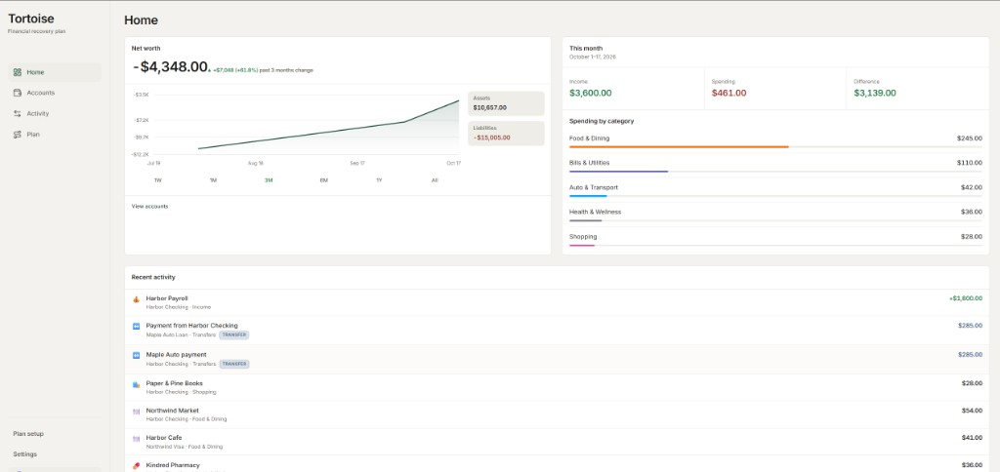
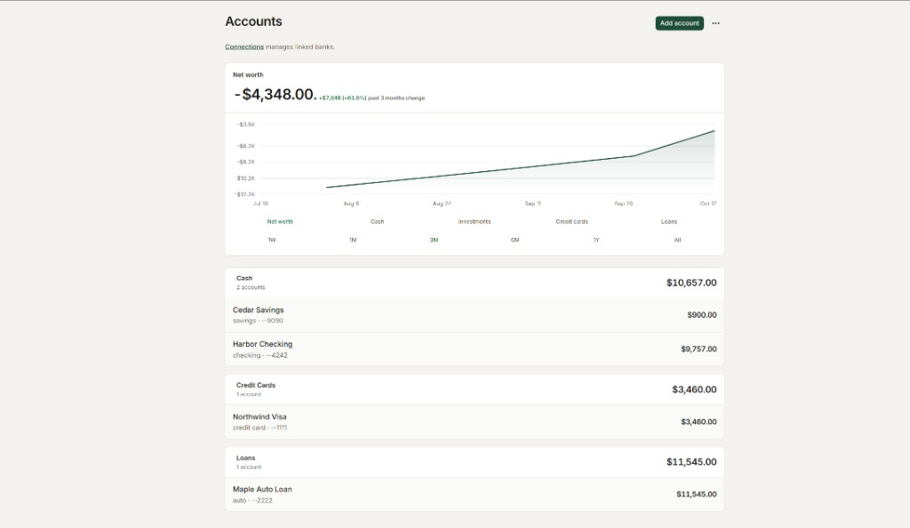
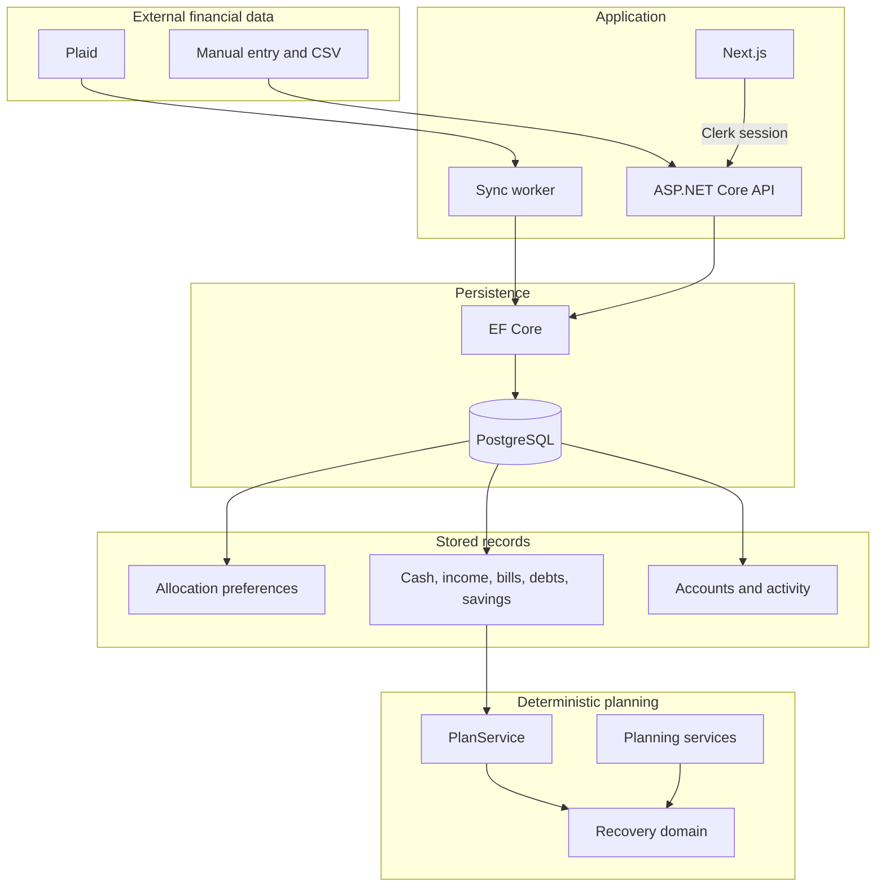

# Cardui

Cardui is a personal finance and debt recovery application designed to help households understand their financial position and build a realistic path out of debt. The signed-in interface is titled Tortoise.

Unlike traditional budgeting tools that focus primarily on tracking spending, Cardui connects day-to-day cash flow with debt repayment planning. Its deterministic planning engine models payoff strategies, upcoming obligations, and available cash, allowing users to explore financial decisions before committing to a plan.

The application combines a Next.js frontend, an ASP.NET Core API, PostgreSQL, Clerk authentication, and optional Plaid connectivity. An AI-guided planning experience is under development.

## Screenshots

These screens use a synthetic household created for this document. The names and amounts are fictional.



Home shows net worth, this month's income and spending, and recent activity.



Accounts shows balance history and the cash, card, and loan inventory.

## Capabilities

- Clerk identifies the owner. The API creates one household for that owner and scopes every financial read and write to it.
- Accounts and transactions can be entered by hand or imported from a CSV. An opening balance is not income. Linking a bank through Plaid is optional.
- Home, Accounts, Activity, and Plan are the primary destinations, in that order.
- Plan setup stores income, bills, debts, the plan budget, and savings. Those are the facts the recovery calculation reads. Allocation preferences are saved on their own and are not part of that calculation.
- Plan previews payoff order, freed payments, a cash outlook, and 30-day spendable cash. Try changes can preview an extra payment, income loss, a windfall, flexible spending, and cash to keep. Nothing is stored until the plan is saved.
- A household can keep one draft and one accepted plan. Later edits to pay, bills, or debts do not rewrite an accepted version. Accepting a plan does not schedule a payment.

## Architecture

External activity and the planning calculation stay on different paths. Plaid, manual entry, and CSV import become account and transaction records. The recovery calculation does not read those rows, and it does not read allocation preferences. It reads cash, income, bills, debts, and savings.



`PlanService` loads the household's planning facts and calls the recovery domain. Those domain types only read values and return a result. They do not use the database, HTTP, or a clock. The Plan page shows that result. Saving a plan runs the calculation again and stores a version. The browser does not send the plan document.

Planning services can describe a forecast or draft a change from the same domain rules. No page calls them, and a model request does not send tools. A repeated charge stays a suggestion until someone saves it as a bill.

The calculation rules are in [`docs/reference/recovery-calculations.md`](docs/reference/recovery-calculations.md). The record and screen map is in [`docs/design/planning-architecture.md`](docs/design/planning-architecture.md).

## Technical decisions

- The server resolves the household from the Clerk session. The browser does not supply a household id.
- Recovery results are reproducible from the stored facts. The same inputs produce the same numbers.
- A financial record does not require a bank connection. A stored Plaid access token is encrypted with ASP.NET Data Protection before it is written.
- Guided conversation, where it exists, has to call the same calculation as the Plan page. It cannot invent a balance, a date, or a surplus.

## Current status

The manual planning path is in the application: accounts, activity, the planning editors, and a saved plan. There is no chat screen, no conversation route, and no live model call in ordinary use. The planning-model API key and model stay blank until a later review asks for a live call.

Phone access and an MX bank connection are not built. Plaid is the connector in the application.

Direction and the remaining journey are in [`docs/roadmap.md`](docs/roadmap.md). Conversation limits are in [`docs/reference/planning-conversation.md`](docs/reference/planning-conversation.md).

## Local development

Commands are Windows PowerShell, run from the repository root unless a step says otherwise. Keep database, Clerk, and Plaid values in User Secrets or `frontend/.env.local`. Do not add them to source, documentation, or logs.

### Stack

| Piece | What it is |
| --- | --- |
| API | .NET 10, ASP.NET Core, EF Core, PostgreSQL 16 |
| Web | Next.js 16, React 19, TypeScript, Tailwind CSS 4 |
| Sign-in | Clerk |
| Bank sync | Plaid, optional, through a one-shot worker |
| Tests | xUnit in `tests/Cardui.Tests`, Node test scripts in `frontend/` |

`global.json` pins the .NET SDK to 10.0.301. `frontend/package.json` pins pnpm to 10.33.0. Continuous integration uses Node.js 22.

### Repository

- `api/`: HTTP API and EF Core migrations
- `frontend/`: Next.js application
- `worker/`: one-shot Plaid sync
- `tests/Cardui.Tests/`: .NET tests
- `docs/`: roadmap, decisions, designs, and calculation rules. Start at [`docs/README.md`](docs/README.md)

### Prerequisites

- .NET SDK 10.0.301
- Docker Desktop with Docker Compose
- Node.js 22 and pnpm 10.33.0
- `dotnet ef`
- Optional Plaid sandbox credentials, only for bank linking and sync

### Setup

```powershell
docker compose up -d postgres
```

PostgreSQL is the `postgres:16` service in `docker-compose.yml`. Its data stays in the `cardui_pgdata` volume, and the port is bound to `127.0.0.1:5433`. Build the API connection string from that file. Do not paste the finished string into this repository.

```powershell
dotnet user-secrets set "ConnectionStrings:DefaultConnection" "<local PostgreSQL connection string>" --project .\api
dotnet user-secrets set "Clerk:Issuer" "<Clerk Frontend API origin>" --project .\api
dotnet restore .\Cardui.sln
dotnet ef database update --project .\api --startup-project .\api
```

`Clerk:Issuer` is the HTTPS origin the API uses to download Clerk's public signing keys. Do not put the Clerk secret key in the API configuration. Financial routes require a session. `/api/health` does not. `POST /api/plaid/webhook` is anonymous and checks the Plaid signature before it reads the body.

Plaid and the planning model are optional. Leave them unset for manual use. For each one, set every value or none of them. A partial set stops startup.

```powershell
dotnet user-secrets set "Plaid:ClientId" "<Plaid sandbox client ID>" --project .\api
dotnet user-secrets set "Plaid:Secret" "<Plaid sandbox secret>" --project .\api
dotnet user-secrets set "Plaid:Environment" "sandbox" --project .\api
dotnet user-secrets set "Plaid:ClientName" "Cardui" --project .\api
```

```powershell
dotnet user-secrets set "PlanningModel:ApiKey" "<OpenAI API key>" --project .\api
dotnet user-secrets set "PlanningModel:Model" "<model id>" --project .\api
```

The API and worker share the gitignored `.data-protection-keys` directory. Production must set `DataProtection:KeysPath`, `DataProtection:CertificatePath`, and public `https` values for `AllowedHosts`, `Cors:AllowedOrigins`, and `Clerk:AuthorizedParties`.

```powershell
@"
API_BASE_URL=http://localhost:5235
NEXT_PUBLIC_API_BASE_URL=http://localhost:5235
NEXT_PUBLIC_CLERK_PUBLISHABLE_KEY=<Clerk publishable key>
CLERK_SECRET_KEY=<Clerk secret key>
NEXT_PUBLIC_CLERK_SIGN_IN_URL=/sign-in
NEXT_PUBLIC_CLERK_SIGN_UP_URL=/sign-up
"@ | Set-Content .\frontend\.env.local

Push-Location .\frontend
pnpm install --frozen-lockfile
Pop-Location
```

### Run

Use two terminals.

```powershell
dotnet run --project .\api --launch-profile http
Invoke-RestMethod http://localhost:5235/api/health
```

`status` is `ok` when the API is ready.

```powershell
Push-Location .\frontend
pnpm dev
Pop-Location
```

Open `http://localhost:3000`.

The worker has its own User Secrets store. It runs one sync pass and exits. Without Plaid credentials it skips bank sync. If connected items exist and those credentials are missing, it exits with code 1. Scheduling notes are in [`worker/README.md`](worker/README.md).

```powershell
dotnet user-secrets set "ConnectionStrings:DefaultConnection" "<local PostgreSQL connection string>" --project .\worker
dotnet run --project .\worker
```

```powershell
docker compose stop
```

That keeps the PostgreSQL volume. `docker compose down --volumes` deletes the local database.

### Tests

```powershell
dotnet test .\Cardui.sln
dotnet build .\worker\worker.csproj --configuration Release
```

```powershell
Push-Location .\frontend
pnpm test
pnpm lint
pnpm format:check
pnpm build
Pop-Location
```

[`.github/workflows/ci.yml`](.github/workflows/ci.yml) runs on pull requests and on pushes to `main`. It runs the .NET tests, the worker Release build, and the frontend test, lint, format, and production build. It does not start PostgreSQL or apply migrations, and it does not deploy. The frontend build uses placeholder Clerk keys so the sign-in shell can compile.

## Further reading

- [`docs/README.md`](docs/README.md): priorities, open decisions, and the document map
- [`docs/roadmap.md`](docs/roadmap.md): product direction and what each phase built
- [`docs/design/planning-architecture.md`](docs/design/planning-architecture.md): records, rules, and the Plan page
- [`docs/reference/recovery-calculations.md`](docs/reference/recovery-calculations.md): interest, payoff, forecast, and spendable cash
- [`docs/reference/planning-conversation.md`](docs/reference/planning-conversation.md): what the planning model can and cannot do
