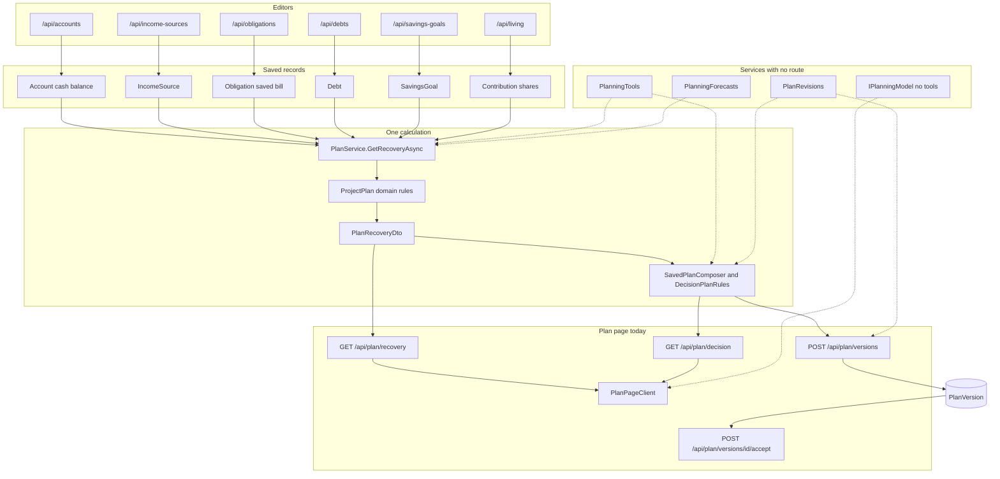

# Planning architecture

Status: Approved
Updated: 2026-10-17

Zach approved this map on October 17, 2026, including the direction that
desktop guided recovery and MX connectivity come before phone access. The
roadmap records that order. This document does not close Linear TOR-2,
TOR-3, or TOR-4. Whether the map covers the work Linear still titles TOR-2
is still open. Linear was not changed. No calculation, route, or screen
changed with the approval.

The October 17 reading inventoried the recovery calculation, the saved
plan, and the screens that call them. This cleanup re-checked
`PlanService.GetRecoveryAsync`: it loads cash, outlook incomes, saved
bills, the savings outlook, and contribution shares, and it does not load
allocation or conversations. The file paths below existed on October 17,
2026. The methods were not executed again. Tests were not run for the
original map, and they were not run for this copy. Interest and
amortization steps are in
[`docs/reference/recovery-calculations.md`](../reference/recovery-calculations.md).
Conversation limits are in
[`docs/reference/planning-conversation.md`](../reference/planning-conversation.md).

There are no MX types in `api/`. Plaid remains the connector in the app.
Bank records stay independent of the connector, as in decision 0002. An MX
connection is not a claim that Plaid is removed, and its scope is not
written.

## How a recommendation is produced

`PlanService.GetRecoveryAsync` loads the records, runs the domain rules,
and returns `PlanRecoveryDto`. Nothing in that response is stored.

The Plan page shows that response. Saving a plan calculates it again and
stores the decision plan. Conversational services, where they exist, call
the same methods. They have no route and no screen.

Allocation preferences and activity transactions are not inputs to
`GetRecoveryAsync`.

## Records

These rows are the facts the calculation reads. Editors write them. The
calculation does not.

| Record | File | What the recovery path uses |
| --- | --- | --- |
| `Account` | `api/Models/Account.cs` | Active, unarchived cash accounts in the planning currency. `AccountsService.GetCashPositionAsync` sums `CurrentBalance` and reads the latest balance-snapshot date. |
| `IncomeSource` | `api/Models/IncomeSource.cs` | Take-home, low take-home, cadence, next date, raises, contributor, and reliability. `IncomeSourcesService.GetOutlookIncomesAsync`. |
| `Obligation` | `api/Models/Obligation.cs` | Saved bills only: amount, cadence, and next due date. `ObligationsService.GetOutlookBillsAsync`. A suggestion is a different query. |
| `Debt` | `api/Models/Debt.cs` | The balance and credit limit already in use, APR, promotion, minimum, remaining term, and next due date. `DebtsService.GetDebtsAsync`, then `PlanService.ToDebt`. |
| `SavingsGoal` | `api/Models/SavingsGoal.cs` | Living spending, the cash floor, the starting reserve, and contributions. `SavingsGoalsService.GetOutlookAsync` calls `HouseholdSavings.Project`. |
| Contribution shares | Living service, not a plan row | `LivingService.GetSharedIncomesAsync` calls `ContributionShare.Apply` on the outlook incomes. |
| `PlanVersion` | `api/Models/PlanVersion.cs` | The stored decision plan. Written only by save and accept. |
| `AllocationPreference` | `api/Models/AllocationPreference.cs` | Saved splits. Not loaded by `PlanService`. |
| `Conversation` | `api/Models/Conversation.cs` | Turns, notes, consent, and plan links. Not loaded by `PlanService`. |

`ObligationsService.GetSuggestionsAsync` notices repeated activity through
`RecurringSuggestions.Find`. Those suggestions are not in
`GetOutlookBillsAsync`. A bill enters the forecast after it is saved on the
bill form. The suggestion query was not re-opened for this copy. The bill
load on `PlanService` was.

## Domain rules

These types do not load or save rows. `PlanService.ProjectPlan` calls them.
The descriptions are the responsibilities in the source summaries.

| Rule | File | Responsibility |
| --- | --- | --- |
| `PlanCashScenarioRules.Reject` | `api/Domain/Recovery/PlanCashScenarioRules.cs` | Rejects a preview the forecast cannot run. |
| `PayoffChoiceRules.Reject` | `api/Domain/Recovery/PayoffChoiceRules.cs` | Rejects a priority or reclaim amount the payoff cannot use. |
| `HouseholdRecovery.Prepare` | `api/Domain/Recovery/HouseholdRecovery.cs` | Builds the payoff input. A debt with no balance is listed apart, not treated as paid off. |
| `PayoffPriority.Compare` | `api/Domain/Recovery/PayoffPriority.cs` | Compares avalanche with a minimum-release order, a utilization order, and a pay-first or pay-last constraint. |
| `PayoffOrdering` | `api/Domain/Recovery/PayoffOrdering.cs` | Orders debts. Called from `PayoffPriority` and again from `PayoffRollover`. |
| `PayoffProjection.Project` | `api/Domain/Recovery/PayoffProjection.cs` | Projects one order for the priority comparison. |
| `PayoffRollover.Compare` | `api/Domain/Recovery/PayoffRollover.cs` | Compares rolling a freed payment forward, keeping some of it, and keeping all of it. |
| `CashFlowRecovery.Track` | `api/Domain/Recovery/CashFlowRecovery.cs` | Dates when each payoff removes a minimum, and the breathing room after that. |
| `PlanCashScenarioAdjustment.Apply` | `api/Domain/Recovery/PlanCashScenarioAdjustment.cs` | Applies income loss, a windfall, and temporary living-spending or cash-floor amounts to the loaded facts. Cash on hand does not change. |
| `HouseholdCashOutlook.Project` | `api/Domain/Recovery/HouseholdCashOutlook.cs` | Forecasts cash on each freed-cash path, at typical pay and, when recorded, low pay. |
| `CashForecast.Project` | `api/Domain/Recovery/CashForecast.cs` | Projects the day-by-day cash the outlook and the spendable estimate both use. |
| `SpendableRules.Project` | `api/Domain/Recovery/SpendableRules.cs` | Estimates the lowest spendable cash over 30 days. Steady pay only. A windfall is left out. |
| `DebtAmortization.Project` | `api/Domain/Recovery/DebtAmortization.cs` | Projects one debt month by month. Called from the cash forecast, the spendable estimate, and a restructuring comparison. |
| `DecisionPlanRules.Compose` | `api/Domain/Plans/DecisionPlanRules.cs` | Turns one recovery result and one freed-cash choice into at most three ranked actions, plus milestones, assumptions, risks, and gaps. |
| `PlanVersionRules.Save` and `Accept` | `api/Domain/Plans/PlanVersionRules.cs` | Decides whether a save creates, replaces, or keeps a draft, and whether an accept matches the open draft. |
| `RestructuringComparisonRules.TryCompare` | `api/Domain/Recovery/RestructuringComparisonRules.cs` | Compares one consolidation loan, balance transfer, or replacement loan with selected debts. |
| `PlanningForecastRules.Compose` | `api/Domain/Planning/PlanningForecastRules.cs` | Words a forecast from numbers already on `PlanRecoveryDto`. It rejects a claim that adds a number. |
| `PlanRevisionRules` | `api/Domain/Planning/PlanRevisionRules.cs` | Lists what accepting would change, and rejects a review whose conversation or plan has moved. |

`HouseholdSavings.Project` and `ContributionShare.Apply` run before the
recovery rules. They shape the facts. They do not rank a payoff.

`LivingGapCalculator.Measure` runs on the Living page inside
`LivingService.Compose`. `GetRecoveryAsync` does not call it. That absence
was checked from `PlanService`, which calls `GetSharedIncomesAsync` and
does not mention the gap calculator.

## Application services

| Service | File | Responsibility |
| --- | --- | --- |
| `PlanService.GetRecoveryAsync` | `api/Services/Implementations/PlanService.cs` | Loads facts, checks the scenario, and runs `ProjectPlan`. Returns the preview. |
| `SavedPlanService.GetPreviewAsync` | `api/Services/Implementations/SavedPlanService.cs` | Calls `GetRecoveryAsync`, then `SavedPlanComposer.Compose`. |
| `SavedPlanComposer.Compose` | `api/Services/Implementations/SavedPlanComposer.cs` | Copies one freed-cash path into `DecisionPlanRules.Compose`. |
| `SavedPlanService.SaveDraftAsync` | same file | Calculates that plan again and writes one open draft. A matching draft is returned unchanged. |
| `SavedPlanService.AcceptAsync` | same file | Accepts that draft and marks the previous accepted plan superseded. |
| `RestructuringService.CompareAsync` | `api/Services/Implementations/RestructuringService.cs` | Loads selected debts, cash, and the savings outlook, then calls `RestructuringComparisonRules.TryCompare`. |
| `PlanningForecasts.DescribeAsync` | `api/Services/Implementations/PlanningForecasts.cs` | Calls `GetRecoveryAsync` and `PlanningForecastRules.Compose`. No route. |
| `PlanningTools.RequestCalculationAsync` | `api/Services/Implementations/PlanningTools.cs` | Calls `GetRecoveryAsync`. |
| `PlanningTools.CompareScenariosAsync` | same file | Calls `GetRecoveryAsync` twice. |
| `PlanningTools.CompareRestructuringAsync` | same file | Calls `RestructuringService.CompareAsync`. |
| `PlanningTools.DraftPlanChangeAsync` | same file | Calls `GetPreviewAsync`. It does not save. |
| `PlanRevisions.ReviewAsync` | `api/Services/Implementations/PlanRevisions.cs` | Calculates the decision plan again and compares it with the conversation and the saved versions. |
| `PlanRevisions.AcceptAsync` | same file | Calls the saved-plan draft and accept path when the review token still matches. |

Fact proposals, questions, shares, and the model call do not calculate a
payoff. `IPlanningModel.ReplyAsync` sends no tools. The service rows other
than `PlanService` were not re-opened method by method for this copy. Their
files exist.

## HTTP and screens

`PlanController` is the only controller on this path.

| Route | Method | Caller |
| --- | --- | --- |
| `GET /api/plan/recovery` | `GetRecovery` | `frontend/lib/api/server/plan.ts` `getPlanRecovery`, used by `frontend/features/plan/server/loadPlanPage.ts`. A changed preview uses `frontend/lib/api/browser/plan.ts` from `usePlanScenario`. |
| `GET /api/plan/decision` | `GetDecision` | `frontend/lib/api/browser/savedPlan.ts` `getDecisionPlan`, from `useSavedPlan`. |
| `GET /api/plan/versions` and `GET /api/plan/versions/{id}` | `GetVersions`, `GetVersion` | `listPlanVersions` in the same client. |
| `POST /api/plan/versions` | `SaveVersion` | `savePlanVersion`, from `useSavedPlan`. |
| `POST /api/plan/versions/{id}/accept` | `AcceptVersion` | `acceptPlanVersion`, from `useSavedPlan`. |
| `POST /api/plan/restructuring` | `CompareRestructuring` | `frontend/lib/api/browser/restructuring.ts`, from `useRestructuringComparison`. |

`frontend/features/plan/PlanPageClient.tsx` owns the page. The page load
does not call the decision or restructuring routes. The controller routes
were confirmed from `PlanController`. The frontend caller names were not
re-opened for this copy.

The editors that write the facts, and are not the recovery calculation:

| Route | Controller |
| --- | --- |
| `GET` and `POST /api/accounts`, plus archive, restore, and reconciliation | `api/Controllers/AccountsController.cs` |
| `GET`, `POST`, and `PUT /api/income-sources` | `api/Controllers/IncomeSourcesController.cs` |
| `GET`, `POST`, and `PUT /api/obligations`, plus suggestions | `api/Controllers/ObligationsController.cs` |
| `GET`, `POST`, and `PUT /api/debts`, plus follow and overrides | `api/Controllers/DebtsController.cs` |
| `GET` and `PUT /api/living` | `api/Controllers/LivingController.cs` |
| `GET` and `POST /api/savings-goals` | `api/Controllers/SavingsGoalsController.cs` |
| `GET` and `PUT /api/allocation` | `api/Controllers/AllocationController.cs` |

## One household, from records to a saved plan

This trace follows the methods above. It uses no household's amounts. The
code does not special-case a sample household.

1. The account, paycheck, bill, debt, and savings editors write their rows
   through the controllers in the table above. Activity may show a repeated
   charge. That charge stays a suggestion until the bill form saves it.
2. Opening Plan calls `loadPlanPage`, then `GET /api/plan/recovery` with the
   default scenario. `PlanController.GetRecovery` calls
   `PlanService.GetRecoveryAsync`.
3. The load reads cash accounts, outlook incomes, saved bills, the savings
   outlook, and incomes after contribution shares. Debts are loaded for the
   payoff. Allocation is not read.
4. `ProjectPlan` prepares the debts, compares payoff orders, compares the
   three freed-cash paths, tracks breathing room, applies the scenario to
   cash, projects the cash outlook, and estimates 30-day spendable cash.
   The response includes all three paths. The screen chooses which one to
   emphasize.
5. Changing extra, income loss, a windfall, flexible spending, cash to keep,
   priority, or reclaim calls `getPlanRecovery` again from `usePlanScenario`.
   The previous response stays visible while that request runs. Nothing is
   written.
6. Saving calls `GET /api/plan/decision`, which is
   `SavedPlanService.GetPreviewAsync`. That calculates recovery again and
   composes the decision plan for the selected path. `POST /api/plan/versions`
   calculates it a second time inside `SaveDraftAsync` and stores a
   `PlanVersion` draft. The browser does not send the plan document.
7. Accept calls `POST /api/plan/versions/{id}/accept`. `PlanVersionRules.Accept`
   requires that id to be the open draft, or the plan that is already
   accepted. The accepted copy stays as stored. Later edits to pay, bills,
   or debts do not rewrite it. No money moves.

A restructuring comparison is a side path. The offer is posted to
`POST /api/plan/restructuring`. The offer is not saved and is not an input
to the decision plan.

These calls exist and are not reachable from a page. Each one was read in
the October 17 source pass. None was executed then, and none was executed
for this copy.

- `PlanningTools.RequestCalculationAsync` and `PlanningForecasts.DescribeAsync`
  both call `GetRecoveryAsync`. The forecast service then words the numbers.
- `PlanningTools.DraftPlanChangeAsync` stops at `GetPreviewAsync`.
- `PlanRevisions.ReviewAsync` calculates the decision plan and returns a
  review token. `PlanRevisions.AcceptAsync` saves and accepts only when
  that token still matches. It does not link the version on the conversation.
- `IPlanningModel.ReplyAsync` does not call any of these.

Solid arrows are called by the Plan page. Dashed arrows are service methods
with no controller. The model arrow means a reply is not connected to the
calculation.

## Boundaries worth a decision

These are overlaps and unused doors found in the October 17 source reading.
They are not labeled defects. This cleanup did not re-measure how many
times each rule runs.

- `GetRecoveryAsync` both loads records and runs the calculation.
  `SavedPlanService` both composes the decision plan and writes versions.
  The domain rules themselves stay free of the database.
- `ProjectPlan` calls `HouseholdRecovery.Prepare` twice, and a third time
  when monthly extra is greater than zero. `PayoffOrdering.Avalanche` runs
  inside `PayoffPriority.Compare` and again inside `PayoffRollover.Compare`.
  `CashForecast.Project` runs for the outlook and again for the spendable
  estimate.
- `PlanningTools.RequestCalculationAsync` and
  `PlanningForecasts.DescribeAsync` both start from `GetRecoveryAsync`.
  The forecast adds wording and tradeoffs. The tool returns the recovery
  response the Plan page already receives.
- `PlanningTools.DraftPlanChangeAsync` and `SavedPlanService.GetPreviewAsync`
  are the same preview. `PlanRevisions.AcceptAsync` and
  `PlanController.AcceptVersion` both end in `SavedPlanService`, with
  different guards. Only the controller is on a route.
- Saved allocation is a Plan setup record and a planning-tool summary. It
  is not an input to the payoff or the cash outlook. Whether it should
  remain outside the recovery calculation is still open.
- A conversation can link a `PlanVersion`, and a review can accept one.
  Accept does not create that link. The two associations are separate.
- Bank balances reach the forecast only as `Account.CurrentBalance`. The
  repository has Plaid sync and manual balances. It has no MX types.
