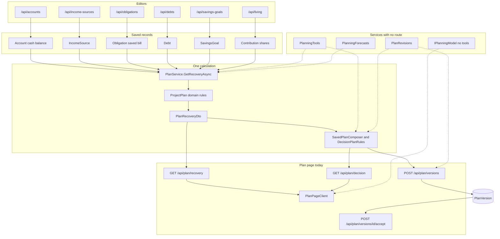

Date: 2026-10-17
Status: Approved 2026-10-17
PR: None

# Planning architecture

## Increment

The architecture map requested while continuing TOR-5. The readiness report
in [`2026-10-17-007-conversational-planning-readiness.md`](2026-10-17-007-conversational-planning-readiness.md)
stays as written. This report inventories the recovery calculation, the
saved plan, and the screens that call them. No code, calculation, route, or
screen changed. TOR-3 and TOR-4 were not done. Tests were not run. Linear
was not changed.

Linear still titles TOR-5 "Assess conversational planning readiness" and
TOR-2 "Map the planning architecture and data flow." This request asked for
the architecture deliverables here and said not to begin TOR-2. The overlap
is a decision at the end. It is not a claim that TOR-2 is closed.

## How a recommendation is produced

Cardui turns saved household facts into a recovery recommendation in one
place: `PlanService.GetRecoveryAsync`. That method loads the records, runs
the domain rules, and returns `PlanRecoveryDto`. Nothing in that response
is stored.

The Plan page shows that response. Saving a plan calculates it again and
stores the decision plan. A later conversational path, where one exists in
services, calls the same two methods. It has no route and no screen.

Allocation preferences and activity transactions are not inputs to
`GetRecoveryAsync`. That is verified from the method's loads, not inferred
from a missing comment.

## Records

These rows are the facts the calculation reads. Editors write them. The
calculation does not.

| Record | File | What the recovery path uses |
| --- | --- | --- |
| `Account` | `api/Models/Account.cs` | Active, unarchived cash accounts in the planning currency. `AccountsService.GetCashPositionAsync` sums `CurrentBalance` and reads the latest balance-snapshot date. |
| `IncomeSource` | `api/Models/IncomeSource.cs` | Take-home, low take-home, cadence, next date, raises, contributor, and reliability. `IncomeSourcesService.GetOutlookIncomesAsync`. |
| `Obligation` | `api/Models/Obligation.cs` | Saved bills only: amount, cadence, and next due date. `ObligationsService.GetOutlookBillsAsync`. A suggestion is a different query. |
| `Debt` | `api/Models/Debt.cs` | The balance and credit limit already in use, APR, promotion, minimum, remaining term, and next due date. `DebtsService.GetDebtsAsync`, then `PlanService.ToDebt`. |
| `SavingsGoal` | `api/Models/SavingsGoal.cs` | Living spending, the cash floor, the starting reserve, and contributions. `SavingsGoalsService.GetOutlookAsync` calls `HouseholdSavings.Project`. |
| Contribution shares | Living service, not a plan row | `LivingService.GetSharedIncomesAsync` calls `ContributionShare.Apply` on the outlook incomes. |
| `PlanVersion` | `api/Models/PlanVersion.cs` | The stored decision plan. Written only by save and accept. |
| `AllocationPreference` | `api/Models/AllocationPreference.cs` | Saved splits. Not loaded by `PlanService`. |
| `Conversation` | `api/Models/Conversation.cs` | Turns, notes, consent, and plan links. Not loaded by `PlanService`. |

`ObligationsService.GetSuggestionsAsync` notices repeated activity through
`RecurringSuggestions.Find`. Those suggestions are not in
`GetOutlookBillsAsync`. A bill enters the forecast after it is saved on the
bill form.

## Domain rules

These types do not load or save rows. `PlanService.ProjectPlan` calls them
in this order. The descriptions are the responsibilities in the source
summaries. They are not a walk through the interest formula. That walk is
TOR-3.

| Rule | File | Responsibility |
| --- | --- | --- |
| `PlanCashScenarioRules.Reject` | `api/Domain/Recovery/PlanCashScenarioRules.cs` | Rejects a preview the forecast cannot run. |
| `PayoffChoiceRules.Reject` | `api/Domain/Recovery/PayoffChoiceRules.cs` | Rejects a priority or reclaim amount the payoff cannot use. |
| `HouseholdRecovery.Prepare` | `api/Domain/Recovery/HouseholdRecovery.cs` | Builds the payoff input. A debt with no balance is listed apart, not treated as paid off. |
| `PayoffPriority.Compare` | `api/Domain/Recovery/PayoffPriority.cs` | Compares avalanche with a minimum-release order, a utilization order, and a pay-first or pay-last constraint. |
| `PayoffOrdering` | `api/Domain/Recovery/PayoffOrdering.cs` | Orders debts. Called from `PayoffPriority` and again from `PayoffRollover`. |
| `PayoffProjection.Project` | `api/Domain/Recovery/PayoffProjection.cs` | Projects one order for the priority comparison. |
| `PayoffRollover.Compare` | `api/Domain/Recovery/PayoffRollover.cs` | Compares rolling a freed payment forward, keeping some of it, and keeping all of it. |
| `CashFlowRecovery.Track` | `api/Domain/Recovery/CashFlowRecovery.cs` | Dates when each payoff removes a minimum, and the breathing room after that. |
| `PlanCashScenarioAdjustment.Apply` | `api/Domain/Recovery/PlanCashScenarioAdjustment.cs` | Applies income loss, a windfall, and temporary living-spending or cash-floor amounts to the loaded facts. Cash on hand does not change. |
| `HouseholdCashOutlook.Project` | `api/Domain/Recovery/HouseholdCashOutlook.cs` | Forecasts cash on each freed-cash path, at typical pay and, when recorded, low pay. |
| `CashForecast.Project` | `api/Domain/Recovery/CashForecast.cs` | Projects the day-by-day cash the outlook and the spendable estimate both use. |
| `SpendableRules.Project` | `api/Domain/Recovery/SpendableRules.cs` | Estimates the lowest spendable cash over 30 days. Steady pay only. A windfall is left out. |
| `DebtAmortization.Project` | `api/Domain/Recovery/DebtAmortization.cs` | Projects one debt month by month. Called from the cash forecast, the spendable estimate, and a restructuring comparison. |
| `DecisionPlanRules.Compose` | `api/Domain/Plans/DecisionPlanRules.cs` | Turns one recovery result and one freed-cash choice into at most three ranked actions, plus milestones, assumptions, risks, and gaps. |
| `PlanVersionRules.Save` and `Accept` | `api/Domain/Plans/PlanVersionRules.cs` | Decides whether a save creates, replaces, or keeps a draft, and whether an accept matches the open draft. |
| `RestructuringComparisonRules.TryCompare` | `api/Domain/Recovery/RestructuringComparisonRules.cs` | Compares one consolidation loan, balance transfer, or replacement loan with selected debts. |
| `PlanningForecastRules.Compose` | `api/Domain/Planning/PlanningForecastRules.cs` | Words a forecast from numbers already on `PlanRecoveryDto`. It rejects a claim that adds a number. |
| `PlanRevisionRules` | `api/Domain/Planning/PlanRevisionRules.cs` | Lists what accepting would change, and rejects a review whose conversation or plan has moved. |

`HouseholdSavings.Project` (`api/Domain/Savings/HouseholdSavings.cs`) and
`ContributionShare.Apply` run before the recovery rules. They shape the
facts. They do not rank a payoff.

`LivingGapCalculator.Measure` runs on the Living page inside
`LivingService.Compose`. `GetRecoveryAsync` does not call it.

## Application services

| Service | File | Responsibility |
| --- | --- | --- |
| `PlanService.GetRecoveryAsync` | `api/Services/Implementations/PlanService.cs` | Loads facts, checks the scenario, and runs `ProjectPlan`. Returns the preview. |
| `SavedPlanService.GetPreviewAsync` | `api/Services/Implementations/SavedPlanService.cs` | Calls `GetRecoveryAsync`, then `SavedPlanComposer.Compose`. |
| `SavedPlanComposer.Compose` | `api/Services/Implementations/SavedPlanComposer.cs` | Copies one freed-cash path into `DecisionPlanRules.Compose`. |
| `SavedPlanService.SaveDraftAsync` | same file | Calculates that plan again and writes one open draft. A matching draft is returned unchanged. |
| `SavedPlanService.AcceptAsync` | same file | Accepts that draft and marks the previous accepted plan superseded. |
| `RestructuringService.CompareAsync` | `api/Services/Implementations/RestructuringService.cs` | Loads selected debts, cash, and the savings outlook, then calls `RestructuringComparisonRules.TryCompare`. |
| `PlanningForecasts.DescribeAsync` | `api/Services/Implementations/PlanningForecasts.cs` | Calls `GetRecoveryAsync` and `PlanningForecastRules.Compose`. No route. |
| `PlanningTools.RequestCalculationAsync` | `api/Services/Implementations/PlanningTools.cs` | Calls `GetRecoveryAsync`. |
| `PlanningTools.CompareScenariosAsync` | same file | Calls `GetRecoveryAsync` twice. |
| `PlanningTools.CompareRestructuringAsync` | same file | Calls `RestructuringService.CompareAsync`. |
| `PlanningTools.DraftPlanChangeAsync` | same file | Calls `GetPreviewAsync`. It does not save. |
| `PlanRevisions.ReviewAsync` | `api/Services/Implementations/PlanRevisions.cs` | Calculates the decision plan again and compares it with the conversation and the saved versions. |
| `PlanRevisions.AcceptAsync` | same file | Calls the saved-plan draft and accept path when the review token still matches. |

Fact proposals, questions, shares, and the model call are inventoried in
the readiness report. They do not calculate a payoff. `IPlanningModel.ReplyAsync`
sends no tools.

## HTTP and screens

`PlanController` (`api/Controllers/PlanController.cs`) is the only
controller on this path.

| Route | Method | Caller |
| --- | --- | --- |
| `GET /api/plan/recovery` | `GetRecovery` | `frontend/lib/api/server/plan.ts` `getPlanRecovery`, used by `frontend/features/plan/server/loadPlanPage.ts`. A changed preview uses `frontend/lib/api/browser/plan.ts` from `usePlanScenario`. |
| `GET /api/plan/decision` | `GetDecision` | `frontend/lib/api/browser/savedPlan.ts` `getDecisionPlan`, from `useSavedPlan`. |
| `GET /api/plan/versions` and `GET /api/plan/versions/{id}` | `GetVersions`, `GetVersion` | `listPlanVersions` in the same client. |
| `POST /api/plan/versions` | `SaveVersion` | `savePlanVersion`, from `useSavedPlan`. |
| `POST /api/plan/versions/{id}/accept` | `AcceptVersion` | `acceptPlanVersion`, from `useSavedPlan`. |
| `POST /api/plan/restructuring` | `CompareRestructuring` | `frontend/lib/api/browser/restructuring.ts`, from `useRestructuringComparison`. |

`frontend/features/plan/PlanPageClient.tsx` owns the page.
`PlanWorkingScenario` edits the temporary scenario. `PlanDecision` saves
and accepts. `PlanDebtPayoff` shows the payoff paths. `PlanOfferComparison`
shows one restructuring offer. The page load does not call the decision or
restructuring routes.

The editors that write the facts, and are not the recovery calculation:

| Route | Controller |
| --- | --- |
| `GET` and `POST /api/accounts`, plus archive, restore, and reconciliation | `api/Controllers/AccountsController.cs` |
| `GET`, `POST`, and `PUT /api/income-sources` | `api/Controllers/IncomeSourcesController.cs` |
| `GET`, `POST`, and `PUT /api/obligations`, plus suggestions | `api/Controllers/ObligationsController.cs` |
| `GET`, `POST`, and `PUT /api/debts`, plus follow and overrides | `api/Controllers/DebtsController.cs` |
| `GET` and `PUT /api/living` | `api/Controllers/LivingController.cs` |
| `GET` and `POST /api/savings-goals` | `api/Controllers/SavingsGoalsController.cs` |
| `GET` and `PUT /api/allocation` | `api/Controllers/AllocationController.cs` |

No controller calls `IPlanningTools`, `IPlanningFacts`, `IPlanningQuestions`,
`IPlanningForecasts`, `IPlanningShares`, `IPlanningCalls`, `IPlanRevisions`,
or `IConversationService`. The frontend has no conversation client. That
absence was checked by search.

## One household, from records to a saved plan

This trace follows the methods above. Amounts are illustrative. The code
does not special-case these figures.

The household has a checking account, one paycheck, one saved rent bill,
and one card with a balance, a rate, a minimum, and a due date. Living
spending and cash to keep are saved on Savings. No extra payment is entered.
The freed-cash choice on screen is to roll a freed payment forward.

1. The account, paycheck, bill, debt, and savings editors write their rows
   through the controllers in the table above. Activity may show a repeated
   charge. That charge stays a suggestion until the bill form saves it.
2. Opening Plan calls `loadPlanPage`, then `GET /api/plan/recovery` with the
   default scenario. `PlanController.GetRecovery` calls
   `PlanService.GetRecoveryAsync`.
3. The load reads cash accounts, outlook incomes, saved bills, the savings
   outlook, and incomes after contribution shares. Debts are loaded for the
   payoff. Allocation is not read.
4. `ProjectPlan` prepares the debts, compares payoff orders, compares the
   three freed-cash paths, tracks breathing room, applies the scenario to
   cash, projects the cash outlook, and estimates 30-day spendable cash.
   The response includes all three paths. The screen chooses which one to
   emphasize.
5. Changing extra, income loss, a windfall, flexible spending, cash to keep,
   priority, or reclaim calls `getPlanRecovery` again from `usePlanScenario`.
   The previous response stays visible while that request runs. Nothing is
   written.
6. Saving calls `GET /api/plan/decision`, which is
   `SavedPlanService.GetPreviewAsync`. That calculates recovery again and
   composes the decision plan for the selected path. `POST /api/plan/versions`
   calculates it a second time inside `SaveDraftAsync` and stores a
   `PlanVersion` draft. The browser does not send the plan document.
7. Accept calls `POST /api/plan/versions/{id}/accept`. `PlanVersionRules.Accept`
   requires that id to be the open draft, or the plan that is already
   accepted. The accepted copy stays as stored. Later edits to pay, bills,
   or debts do not rewrite it. No money moves.

A restructuring comparison is a side path. `PlanOfferComparison` posts the
offer to `POST /api/plan/restructuring`. The offer is not saved and is not
an input to the decision plan.

### The same calculation, without a screen

These calls exist and are not reachable from a page. Each one was read in
source. None was executed for this report.

- `PlanningTools.RequestCalculationAsync` and `PlanningForecasts.DescribeAsync`
  both call `GetRecoveryAsync`. The forecast service then words the numbers.
- `PlanningTools.DraftPlanChangeAsync` stops at `GetPreviewAsync`.
- `PlanRevisions.ReviewAsync` calculates the decision plan and returns a
  review token. `PlanRevisions.AcceptAsync` saves and accepts only when
  that token still matches. It does not link the version on the conversation.
- `IPlanningModel.ReplyAsync` does not call any of these.

Solid arrows are called by the Plan page. Dashed arrows are service methods
with no controller. The model arrow means a reply is not connected to the
calculation.

## Boundaries worth a decision

These are overlaps and unused doors found in the source. They are not
labeled defects.

- `GetRecoveryAsync` both loads records and runs the calculation.
  `SavedPlanService` both composes the decision plan and writes versions.
  The domain rules themselves stay free of the database.
- `ProjectPlan` calls `HouseholdRecovery.Prepare` twice, and a third time
  when monthly extra is greater than zero. `PayoffOrdering.Avalanche` runs
  inside `PayoffPriority.Compare` and again inside `PayoffRollover.Compare`.
  `CashForecast.Project` runs for the outlook and again for the spendable
  estimate.
- `PlanningTools.RequestCalculationAsync` and
  `PlanningForecasts.DescribeAsync` both start from `GetRecoveryAsync`.
  The forecast adds wording and tradeoffs. The tool returns the recovery
  response the Plan page already receives.
- `PlanningTools.DraftPlanChangeAsync` and `SavedPlanService.GetPreviewAsync`
  are the same preview. `PlanRevisions.AcceptAsync` and
  `PlanController.AcceptVersion` both end in `SavedPlanService`, with
  different guards. Only the controller is on a route.
- Saved allocation is a Plan setup record and a planning-tool summary. It
  is not an input to the payoff or the cash outlook.
- A conversation can link a `PlanVersion`, and a review can accept one.
  Accept does not create that link. The two associations are separate.
- Bank balances reach the forecast only as `Account.CurrentBalance`. The
  repository has Plaid sync and manual balances. It has no MX types. Whether
  an MX connection would replace Plaid, or write the same account rows, is
  not decided in this code.

## Product direction

Zach said desktop guided recovery and MX connectivity take priority over
phone access. That conflicts with the current roadmap, which was not edited.

`docs/roadmap.md` still places the phone-access proposal as core journey
item 2, before household scoping and the minimal chat view. Bank
connectivity in that document is Plaid. Plaid Liabilities is recorded there
as deferred. MX does not appear in `docs/roadmap.md` or in the API.

The readiness report's follow-ups still name that core journey order. This
report does not replace them.

## Acceptance criteria

The criteria below are the ones in this request. Linear TOR-5's own text is
the readiness list, which the earlier report covers.

| Requested deliverable | Result |
| --- | --- |
| Inventory with file paths and methods | Recorded above for the recovery, forecast, scenario, restructuring, and plan-persistence path. Conversational services stay in the readiness report. |
| Plain-English responsibility | One sentence each, from the method's job. Interest and amortization steps are not explained. |
| Dependencies across records, domain, services, API, and screens | Recorded above. |
| One trace, with the page path separate from the unrouted services | Recorded above. |
| Mermaid diagram | Recorded above. |
| Unclear boundaries, without calling them defects | Recorded above. |
| Map to TOR-5 and name remaining gaps | This table. |

Still open for TOR-5 as Linear writes it: review of the readiness report.
This architecture report does not repeat that read, preview, and save list.

Still open because this request left them to other issues:

- TOR-3: the payoff, interest, and cash formulas, their assumptions, and
  any calculation that should be simplified.
- TOR-4: which of these rules have tests, and which financial cases do not.
- A Keep, Simplify, Defer, or Investigate label for each component. TOR-1
  asks for that. This report only names boundaries.

## Verification

Source was read. No test, live call, database command, or network change
was run. No application code changed.

## Approval

Approved by Zach on October 17, 2026. The approval includes the direction
that desktop guided recovery and MX connectivity come before phone access,
and it includes updating the roadmap and the other planning documents to
say that. TOR-3 and TOR-4 stay open. Linear was not changed. No calculation,
route, or screen changed with this approval.

## Pending decision

- Whether this report covers the work Linear still titles TOR-2.
- Whether a saved allocation should remain outside the recovery calculation.

## Correction

October 17, 2026. The product-direction section above described a conflict
with the roadmap. That conflict was the state before this approval. The
roadmap now records the directed order.
